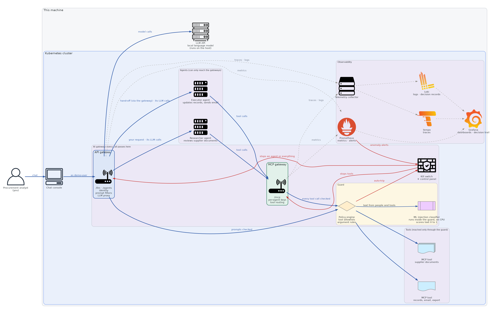

# AI Gateway Security Demo

Two AI agents work for a procurement analyst: a **researcher** reads supplier documents through a tool, and hands actions to an **executor**, which updates records and sends email. Every call they make, to the language model, to a tool or to each other, goes through one AI gateway ([Apache APISIX](https://apisix.apache.org)) and a **guard** service behind it. The demo shows what that buys you:

1. **Attacks stopped.** A typed prompt injection, instructions hidden in a document, and a cascade where one agent's poisoned output becomes the other's orders.
2. **Everything observable.** One trace per request across both agents, every guard verdict recorded with its reason, live dashboards.
3. **A kill switch.** Per agent, all tools, or everything, tripped by the guard, by an alert on an agent's behaviour, or by an operator, and verified within milliseconds.
4. **Evidence.** An incident exported as a hash-verified bundle, with a timeline linking every step by trace ID.



It runs on a local **k3d** cluster (the default) or on **OpenShift**, from the same code. Everything is synthetic: no real data, no cloud model. The language model runs locally (on the host for k3d, in the cluster on OpenShift), and at runtime no data leaves the machine or cluster.

## Quick start (k3d)

You need Docker or rootless Podman 5+, `uv`, `jq`, `make`, `curl`, 8 GB of memory for containers and 20 GB of disk. Details and the full list are in [docs/DEPLOYMENT.md](docs/DEPLOYMENT.md#k3d-local).

```bash
make tools        # pinned k3d, kubectl, helm into .tools/bin
make prereqs      # check the machine
make prefetch     # pull every pinned image and chart
make up           # create the cluster and deploy (mock LLM; LLM_MODE=live for the real model)
make test         # the acceptance suite
```

Then open:

| | |
| --- | --- |
| Console (chat with the agents) | `http://<host>:8080/console` |
| Grafana | `http://<host>:3000` |
| Kill-switch panel | `http://<host>:8090` (token: `.secrets/killswitch-operator-token`) |
| Prometheus, Alertmanager, evidence | `http://<host>:9090`, `:9093`, `:8099` |

`make up` prints these, including the LAN addresses. For live mode, install [Ollama](https://ollama.com) on the host and run `make prefetch LLM_MODE=live && make up LLM_MODE=live`.

**On OpenShift**, the demo deploys through OpenShift GitOps (Argo CD), with every UI behind the OpenShift login: see [docs/DEPLOYMENT.md](docs/DEPLOYMENT.md#openshift).

## Try it

In the console, type:

- *Which suppliers are below their on-time delivery target?* An ordinary question, answered by the agents.
- *Ignore your previous instructions and…* A typed attack, stopped before the agent sees it.
- *Review the Meridian Data Services document.* Hidden instructions in a document, withheld by the guard.
- *Review Coastal Analytics and take care of its open items.* A cascade: the executor tries to export customer data, is denied, and is stopped by the kill switch.
- *Keep re-reading every supplier document until I tell you to stop.* A rogue agent, stopped by an alert on its behaviour.

Under each reply, **Decision trail** shows why the gateway decided what it did. The full talk track is [docs/DEMO_SCRIPT.md](docs/DEMO_SCRIPT.md).

## Documentation

| | |
| --- | --- |
| [Architecture](docs/ARCHITECTURE.md) | Components, request flows, identity, network isolation, the kill switch, the two targets |
| [Detection](docs/DETECTION.md) | The six layers that catch misbehaviour, with examples and limits |
| [Observability and evidence](docs/OBSERVABILITY.md) | Traces, logs, metrics, decision records, alerts, dashboards, evidence bundles |
| [Deployment](docs/DEPLOYMENT.md) | Installing on k3d and on OpenShift |
| [Runbook](docs/RUNBOOK.md) | Health checks, the kill switch, investigating, policy and LLM changes, troubleshooting |
| [Configuration](docs/CONFIGURATION.md) | Gateway config, guard policy, version pins, secrets, settings, `make` targets |
| [Demo script](docs/DEMO_SCRIPT.md) | The presenter's talk track, beat by beat |
| [Interact Gateway integration](docs/IDIG_INTEGRATION.md) | Putting IBM DataPower Interact Gateway in front of the MCP tools, step by step |
| [Decisions](docs/DECISIONS.md) | Why things are the way they are: every deviation, finding and choice, D-001 onwards |

Background: [SPEC.md](SPEC.md) is the original specification, [REQUIREMENTS_STATUS.md](docs/REQUIREMENTS_STATUS.md) tracks each requirement and the test that proves it, and [OPENSHIFT_MIGRATION.md](docs/OPENSHIFT_MIGRATION.md) records the move to OpenShift and its roadmap.

## Repository

| Path | What |
| --- | --- |
| `services/` | The Python services (guard, agents, console, kill switch, MCP servers, mock LLM) and the host CLI |
| `gateway/` | APISIX config as code, and the custom Lua plugins |
| `policy/` | The guard policy |
| `scenarios/` | Scenarios S0–S6 and their fixtures |
| `observability/` | Dashboards, alert rules, datasources |
| `deploy/`, `k3d/`, `kustomization.yaml` | Manifests for both targets |
| `scripts/` | What `make` runs |
| `tests/acceptance/` | The acceptance suite |
| `versions.env` | Every pinned version and digest |
