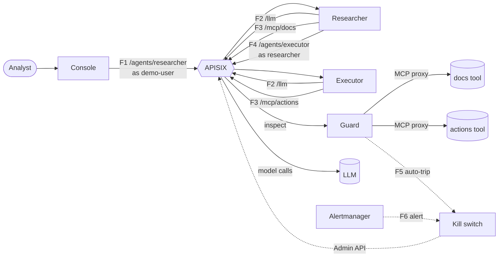
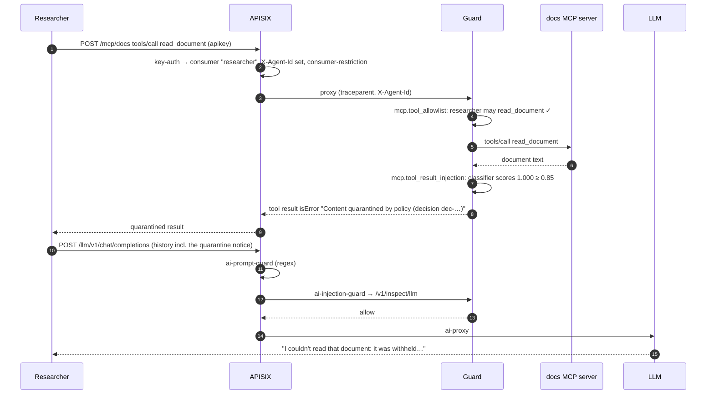
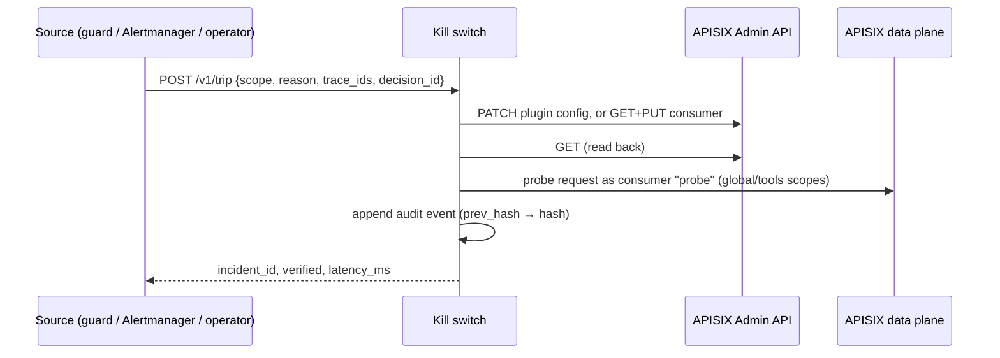

# Architecture

How the demo is built: the components, the paths a request takes, how identity and network isolation work, and what differs between the two targets (a local k3d cluster and OpenShift). For *why* each piece is the way it is, follow the `D-0xx` links into [DECISIONS.md](DECISIONS.md).

*The k3d target. The OpenShift variant is [architecture-openshift.png](architecture-openshift.png). Both are generated by `make diagram` from `docs/diagram/architecture.py` (D-062).*

## The idea in one paragraph

Two AI agents (a *researcher* and an *executor*) work for a procurement analyst. Every call an agent makes goes through one AI gateway (Apache APISIX): calling the language model, using a tool, or handing work to the other agent. Agents have no other network path. That makes the gateway the single place for identity, content inspection, tool policy, telemetry and the kill switch. Inspection APISIX can't do well by itself (classifying text for prompt injection, parsing MCP JSON-RPC, scanning tool results) lives in one **guard** service that APISIX calls or proxies through. Everything the gateway and guard decide is recorded as traces, logs and metrics, and an incident can be exported as a tamper-evident evidence bundle.

## Components

Namespaces are shown for k3d; on OpenShift each is prefixed `aigw-` (`aigw-gateway`, `aigw-ai`, `aigw-observability`), plus `aigw-build` for image builds.

| Component | Namespace | What it does | Built from |
| --- | --- | --- | --- |
| **APISIX** | `gateway` | Authenticates every caller (key-auth), routes, runs the regex prompt filter, calls the guard, proxies to the LLM, enforces the kill switch, emits spans, metrics and access logs | Official Helm chart, traditional mode, custom Lua plugins `ai-injection-guard` and `agent-kill-switch` (`gateway/plugins/`) |
| **etcd** | `gateway` | APISIX's config store | `quay.io/coreos/etcd`, one-replica StatefulSet |
| **Kill switch** | `gateway` | Trip/reset API, Alertmanager webhook, control panel, hash-chained audit log. The only runtime client of the APISIX Admin API | `services/killswitch` (FastAPI) |
| **Guard** | `ai` | Prompt-injection classifier, policy engine, MCP inspecting proxy, decision records, auto-trip | `services/guard` (FastAPI, ONNX Runtime classifier baked into the image) |
| **Researcher, executor** | `ai` | The two agents. Plain loops on the OpenAI and MCP SDKs, no agent framework | `services/agents` (one package, two Deployments) |
| **Console** | `ai` | The presenter's chat app, served through the gateway at `/console`. Holds the `demo-user` key so the browser never sees a secret | `services/console` |
| **MCP servers** | `ai` | `docs`: `list_documents`, `read_document` (seven supplier documents: `supplier-07` hides instructions in a comment, `supplier-06` asks for a data export in ordinary language). `actions`: `update_record`, `send_email`, `export_customer_data`, all simulated | `services/mcp-docs`, `services/mcp-actions` (official MCP SDK, streamable HTTP, JSON responses) |
| **Mock LLM** | `ai` | Scripted OpenAI-compatible model for deterministic runs and tests | `services/mock-llm` |
| **Live LLM** | host / `aigw-ai` | k3d: Ollama on the host (D-002). OpenShift: llama.cpp in the cluster (D-052). Both serve the 4-bit Granite 4.0 Micro | Pinned in `versions.env` |
| **Telemetry** | `observability` | OpenTelemetry collector, Tempo (traces), Loki (logs, decision records), Prometheus + Alertmanager (metrics, alerts), Grafana (dashboards) | k3d: Helm charts. OpenShift: Red Hat operators + Grafana Operator (D-058) |
| **CLI** | host | `make demo`, `make evidence`, `make status`, `make reset` | `services/cli`, run with `uv` |

## Request flows

Every arrow below is an HTTP call through APISIX, except F5 and F6, which are control calls to the kill switch.

| Flow | Path | Gateway route | Who may call |
| --- | --- | --- | --- |
| **F1** Your message | console → APISIX `/agents/researcher/chat` (or `/task`) → researcher | `agent-researcher` | `demo-user` |
| **F2** Model call | agent → APISIX `/llm/v1/chat/completions` → `ai-prompt-guard` → `ai-injection-guard` (guard `/v1/inspect/llm`) → `ai-proxy` → LLM | `llm`, `llm-scripted` | researcher, executor, probe |
| **F3** Tool call | agent → APISIX `/mcp/{docs,actions}` → guard MCP proxy (allowlist, argument rules, result scan) → MCP server | `mcp-docs`, `mcp-actions` | researcher / executor respectively, probe |
| **F4** Hand-off | researcher's `handoff_to_executor` tool → APISIX `/agents/executor/task` → executor | `agent-executor` | researcher |
| **F5** Auto-trip | guard → kill switch `POST /v1/trip` on a critical violation | not through APISIX | guard token |
| **F6** Alert trip | Prometheus rule → Alertmanager → kill switch `POST /v1/alertmanager` | not through APISIX | Alertmanager token |
| **F7** Telemetry | every component → OTLP → collector → Tempo, Loki, Prometheus | not through APISIX | |

Two routes exist for the LLM (D-032). `llm-scripted` matches requests whose `X-Demo-Scenario` header ends in `:scripted` and always sends them to the mock LLM; everything else uses `llm`, whose backend is the current LLM mode (`mock` or `live`). The story prompts in the console (Meridian, Coastal, the rogue agent) are scripted runs, so they behave the same every time, while free chat uses the live model. Both routes carry the same guards and kill switch.

The console also has two small helper routes, both `demo-user` only: `/demo/documents` (uploads, D-047) and `/demo/guard-policy` (reads the live policy version).

### One request, end to end

What happens when the researcher reads a poisoned document:

Every step is a span in one trace, and every guard verdict is a decision record carrying the same trace ID ([OBSERVABILITY.md](OBSERVABILITY.md)).

## Where decisions are made

| Layer | Where | Decides on |
| --- | --- | --- |
| Identity | APISIX `key-auth`, `consumer-restriction` | Who is calling, and whether they may use this route |
| Known attack phrases | APISIX `ai-prompt-guard` | Regex deny list, 400 |
| Injection classifier | guard, via the `ai-injection-guard` plugin | What a person typed, and tool results, 403 |
| Tool policy | guard MCP proxy | Per-agent tool allowlist, argument rules, tools denied to everyone |
| Tool-result scan | guard MCP proxy | Hidden instructions in what a tool returned |
| Behaviour over time | Prometheus alert rules | Tool-call rate, token rate, repeated blocks |
| Kill switch | APISIX config, changed by the kill switch service | Stop one agent, all tools, or everything |

[DETECTION.md](DETECTION.md) walks through each layer with examples and its limits. The guard's policy file is described in [CONFIGURATION.md](CONFIGURATION.md#guard-policy).

The split is deliberate: **APISIX enforces, the guard judges.** The Lua plugin is a thin client; all decision logic is in the guard (`Decider` and `Engine` in `services/guard/src/guard/engine.py`, D-027), so a different decision model can be plugged in without touching the gateway.

## Identity

- **Every caller is an APISIX consumer** with a key-auth key: `demo-user` (the console), `researcher`, `executor`, and `probe` (the kill switch's verification probe). Keys are generated by `scripts/gen-secrets.sh` into Kubernetes Secrets and `.secrets/` (gitignored), never into git.
- **APISIX sets `X-Agent-Id` from the matched consumer** and overwrites any value a client sends. The guard, metrics, alerts and kill switch all key on it.
- **The guard trusts `X-Agent-Id` only because NetworkPolicy lets nothing but APISIX reach it.** The console, for example, is deliberately not allowed to call the guard directly.
- **Metrics that drive alerts come from the gateway and the guard**, never from what an agent reports about itself (D-021, D-037). A compromised agent can't hide its token use.
- **On OpenShift, people sign in with OpenShift OAuth** in front of every UI (an oauth-proxy per UI, admitting users who may `get` Services in `aigw-gateway`). The person's identity stops at that proxy: the console calls the gateway as `demo-user`.

## The kill switch

The kill switch changes APISIX's own configuration; it has no data path of its own. APISIX is the source of truth for whether something is stopped (D-039).

| Scope | What changes in APISIX | Effect |
| --- | --- | --- |
| `agent:<name>` | `agent-kill-switch` plugin added to that consumer (D-013) | That agent gets 503 `kill_switch_engaged` on every route; others are unaffected |
| `tools` | `fault-injection` enabled in plugin config `pc-mcp` | Every MCP call gets 503 |
| `global` | `fault-injection` enabled in `pc-llm`, `pc-mcp` and `pc-agents` | All AI traffic gets 503, before authentication |

- **Three sources:** the guard on a critical violation in enforce mode (F5, completes before the blocked request is answered, D-038); an alert (F6, D-037); the operator, from the control panel or `make trip`.
- **Verified every time** by reading the config back and, for `global` and `tools`, by sending a probe through the gateway (KS-04).
- **Audit log:** one JSON line per event on a PVC, each carrying the previous event's hash, so editing history breaks the chain.
- **Agents halt cleanly:** on a 503 `kill_switch_engaged` an agent stops and reports `halted_by_kill_switch`.
- **Measured:** 15–40 ms from trip to verified on k3d; up to about 180 ms on OpenShift.

## Network isolation

Default-deny NetworkPolicies in the gateway and ai namespaces, with one allow per flow (D-031, D-056):

- Agents and the console reach only APISIX.
- Only APISIX reaches the guard, the agents, the mock LLM and llama.cpp.
- Only the guard reaches the MCP servers.
- Only the kill switch (and on OpenShift the bootstrap Job and the APISIX dashboard's OAuth proxy) reaches the Admin API on 9180.
- Nothing in `ai` reaches the internet (NFR-08). The one exception is the `gguf-fetch` Job on OpenShift, which downloads the model weights and checks them against a pinned SHA-256.
- The console and the guard's policy sidecar may reach the Kubernetes API; each has a Role limited to one ConfigMap (`guard-policy`).

On OpenShift, `scripts/openshift/verify-netpol.sh` proves these from inside the pods: 17 flows, open or blocked as expected, plus the closed Loki Route. On k3d, `make up` runs `scripts/verify-netpol.sh`, which proves the policy controller is enforcing at all (a fresh pod must be cut off from the internet, D-029), and `tests/acceptance/test_network.py` asserts the individual flows.

## Configuration as code

- **Gateway config** (routes, consumers, plugin configs, upstreams, plugin metadata) is JSON in `gateway/`, applied by `scripts/gateway-apply.sh` with PUTs on fixed IDs, then read back; any drift fails the run (GW-08). Consumer keys and per-target addresses are `${VAR}` templates. An engaged kill switch is preserved, so a redeploy can't silently lift a kill.
- **Guard policy** is `policy/policy.yaml`, loaded into the `guard-policy` ConfigMap. A sidecar in the guard pod copies it to the guard within about 2 s of a change (D-059); a file that fails to parse is rejected and the previous policy stays.
- **Every version is pinned** in `versions.env`: images by tag and digest, charts, operators by CSV, the models by revision and SHA-256. `make pin-check` fails on drift.

Details: [CONFIGURATION.md](CONFIGURATION.md).

## Two targets

The same services, gateway config, policy, dashboards and alert rules run on both. What differs is the platform around them.

| | k3d (default) | OpenShift (`TARGET=openshift`) |
| --- | --- | --- |
| Cluster | Created by `make up` on your machine | An existing OpenShift 4.19 cluster |
| How it's deployed | `scripts/up.sh`: `kubectl apply` with `sed` substitution, Helm charts | Argo CD (OpenShift GitOps) syncs this repository; a few cluster-admin scripts run first |
| Images | Built locally, pushed to a k3d registry | Built in the cluster (BuildConfigs in `aigw-build`), rolled out by image triggers |
| Live LLM | Ollama on the host | llama.cpp in `aigw-ai` |
| Telemetry | kube-prometheus-stack, Tempo, Loki, OTel collector Helm charts | Cluster Observability Operator, Tempo Operator, Loki Operator, Red Hat build of OpenTelemetry, Grafana Operator |
| Access | Host ports (8080 gateway and console, 3000 Grafana, 8090 kill switch, 9090, 9093, 8099) | HTTPS Routes behind OpenShift login; the gateway API Route uses API keys only |
| Gateway bootstrap | From the host through a port-forward | An Argo CD Sync hook Job running the same script |
| Pod security | Fixed UIDs | `restricted-v2`, arbitrary UIDs |

[DEPLOYMENT.md](DEPLOYMENT.md) covers installing each. The OpenShift design and its history are in [OPENSHIFT_MIGRATION.md](OPENSHIFT_MIGRATION.md).

## Repository map

| Path | What |
| --- | --- |
| `services/` | All Python services, one `uv` workspace: `agents`, `console`, `guard`, `killswitch`, `mcp-docs`, `mcp-actions`, `mock-llm`, `common` (shared telemetry and app setup), `cli` (host-side) |
| `gateway/` | APISIX config as code, and the custom Lua plugins |
| `policy/policy.yaml` | The guard policy baseline |
| `scenarios/` | Scenario definitions S0–S6, fixtures (documents, attacks, records, mock LLM scripts) |
| `observability/` | Dashboards (generated by `build.py`), alert rules, datasources |
| `deploy/base/` | Workloads shared by both targets |
| `deploy/k3d/`, `k3d/`, `deploy/helm-values/` | k3d-only manifests, the cluster config, chart values |
| `deploy/openshift/` | The OpenShift overlay, operators, telemetry, GitOps Applications, builds |
| `kustomization.yaml` | What Argo CD builds on OpenShift (generated, D-054) |
| `scripts/` | Everything `make` runs; `scripts/openshift/` for OpenShift-only steps |
| `tests/acceptance/` | The acceptance suite (`make test`) |
| `versions.env` | Every pinned version and digest |
