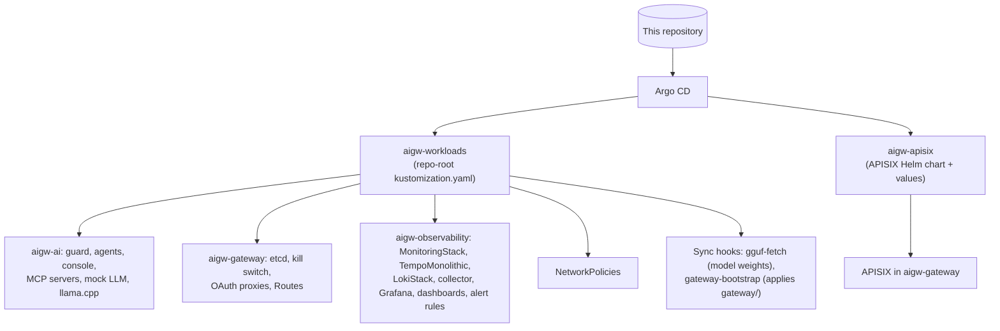

# Deployment

How to install the demo on each target, what the installer does, and how changes reach a running system. The design behind both targets is in [ARCHITECTURE.md](ARCHITECTURE.md#two-targets).

| | k3d | OpenShift |
| --- | --- | --- |
| Where | Your machine (Linux or macOS, amd64 or arm64) | An existing OpenShift 4.19 cluster |
| Install | `make up` | Five scripts, then Argo CD syncs from git |
| Updates | Re-run `make up` (idempotent) | Push to the tracked branch; Argo CD syncs automatically |
| Default LLM mode | `mock` | `live` |

## k3d (local)

### Prerequisites

- **Container runtime:** Docker, or rootless Podman 5 or later. Rootless Podman needs two one-time host settings (cgroup delegation and `net.core.wmem_default`); `make prereqs` checks both and prints the fix (D-009, D-029).
- **Tools:** `uv`, `jq`, `make` and `curl`. `make tools` installs pinned, checksum-verified `k3d`, `kubectl` and `helm` into `.tools/bin`; nothing is installed system-wide, and the demo uses its own kubeconfig (`.kube/config`).
- **Resources:** at least 8 GB of memory for containers and 20 GB of free disk; 16 GB of RAM recommended for live mode.
- **Free host ports:** 8080 (gateway and console), 3000 (Grafana), 8090 (kill-switch panel), 9090 (Prometheus), 9093 (Alertmanager), 8099 (evidence), and 5000 on loopback (image registry). Override any of them in `.env.local`, for example `HOST_PORT_GRAFANA=3001` ([CONFIGURATION.md](CONFIGURATION.md#machine-local-settings)).
- **Live mode only:** [Ollama](https://ollama.com) on the host with the pinned `granite4:micro` model (`make prefetch LLM_MODE=live` pulls it). On Linux it must listen on all interfaces, `OLLAMA_HOST=0.0.0.0:11434`, so the cluster can reach it (D-002).

### Install

```bash
make tools                    # k3d, kubectl, helm into .tools/bin
make prereqs                  # add LLM_MODE=live to also check the host Ollama
make prefetch                 # pull every pinned image and chart (after this, make up works offline)
make up                       # LLM_MODE=mock by default; LLM_MODE=live for the host model
```

`make up` prints the URLs (including LAN addresses) when it finishes. A cold install takes a few minutes after `prefetch`; running it again changes nothing and takes seconds.

### What `make up` does

1. **Checks prerequisites** for the chosen LLM mode.
2. **Creates the registry and cluster** (`k3d/cluster.yaml`: one node, Traefik and ServiceLB off, host ports mapped to NodePorts), or starts a stopped one.
3. **Generates secrets** (`scripts/gen-secrets.sh`): consumer keys, Admin API keys, kill-switch tokens, Grafana password. Into Kubernetes Secrets and `.secrets/` (mode 600, gitignored); re-runs reuse them.
4. **Installs etcd**, then **telemetry**: kube-prometheus-stack, the OTel collector, Tempo and Loki (Helm, pinned versions), plus dashboards, alert rules and datasources.
5. **Builds the service images** locally and pushes them to the k3d registry, tagged with the git SHA (REP-03). Unchanged images aren't rebuilt.
6. **Deploys the ai services** (`deploy/base/ai`), with `${VAR}` placeholders filled in.
7. **Applies the NetworkPolicies** and proves the policy controller is enforcing (`scripts/verify-netpol.sh`).
8. **Installs APISIX** (Helm, with the custom Lua plugins) and **bootstraps the gateway** (`scripts/bootstrap-gateway.sh`): applies `gateway/` through a port-forward to the Admin API, then fails on any drift.
9. **Deploys the kill switch** and runs a **smoke test** through the gateway.

Every step is idempotent: Helm releases are skipped when their inputs haven't changed, the gateway bootstrap only writes objects that differ, and an engaged kill switch or a live policy change survives a re-run (D-016, D-028).

### Remove

```bash
make down      # delete the cluster and registry; keeps the prefetch cache and .secrets/
```

## OpenShift

The OpenShift target runs the same services from the same repository, deployed by **OpenShift GitOps (Argo CD)**. A handful of cluster-admin steps come first, because Argo CD in this design only manages namespaced objects in the `aigw-*` namespaces (OS-11) and never manages Secrets (OS-09).

> **Status.** Everything below has been run on the TechZone cluster, step by step. A single `make up TARGET=openshift`, and a rebuild from scratch on a fresh cluster, are on the [Future roadmap](OPENSHIFT_MIGRATION.md#future-roadmap).

### Prerequisites

- **Cluster:** OpenShift 4.19 or later with OVN-Kubernetes, ODF (Ceph RBD and CephFS storage classes, NooBaa object storage) and about 16 free CPUs on one worker for llama.cpp (12) plus the rest. No GPUs needed.
- **Your access:** `oc login` as a cluster administrator. Scripts use `~/.kube/config` when `TARGET=openshift` (`KUBECONFIG_DEMO` overrides).
- **Tools:** `oc`, `kubectl` (`make tools` installs a pinned one), `jq`, `git`, and `uv` for the CLI and tests. No local container runtime: images are built in the cluster.
- **Git:** the repository's `origin` must be an SSH URL; Argo CD reads it with a read-only deploy key.

### Install

Set `TARGET=openshift` on every command; it selects the kubeconfig and the `aigw-` namespaces.

```bash
export TARGET=openshift

scripts/openshift/install-operators.sh   # 1. operators, pinned to exact CSVs
scripts/openshift/platform.sh            # 2. namespaces, cluster-scoped RBAC, tokens, API server egress
scripts/gen-secrets.sh                   # 3. the demo's Secrets (shared with k3d via .secrets/)
scripts/openshift/build-images.sh        # 4. build every service image in the cluster
scripts/openshift/gitops.sh              # 5. point Argo CD at this repository
```

1. **Operators.** OpenShift GitOps, Cluster Observability Operator, Loki, Tempo, Red Hat build of OpenTelemetry and the Grafana Operator, from OLM. Subscriptions use manual approval, and the script approves only the install plan for the CSV pinned in `versions.env`, then waits for each to succeed.
2. **Platform.** The `aigw-*` namespaces; the image-puller binding on `aigw-build`; cluster-scoped telemetry RBAC (Loki and Tempo tenancy, Argo CD's TokenReview permission) with long-lived token Secrets for the Loki writer and the readers; the API server egress NetworkPolicy, which needs this cluster's control-plane IPs; and the closing of the Loki Operator's public Route (D-063).
3. **Secrets.** Consumer keys, Admin API keys, kill-switch tokens, the Grafana password and the OAuth proxies' cookie secret. Nothing secret is ever in git.
4. **Images.** One binary BuildConfig per service in `aigw-build`, Docker strategy, from `services/Dockerfile` with the pinned base images. Tags `<svc>:latest`, which the workloads follow through image triggers, and `<svc>:<git-tag>`. Unchanged services aren't rebuilt.
5. **GitOps.** Generates a deploy key into `.secrets/argocd-deploy-key`, registers the repository with Argo CD, and creates the `aigw` AppProject and two Applications: `aigw-workloads` (the repo-root `kustomization.yaml`) and `aigw-apisix` (the APISIX Helm chart). **Add the printed public key to the GitHub repository as a read-only deploy key**, once. Argo CD follows `main` by default; `GITOPS_REVISION=<branch>` picks another branch, and later runs keep whatever branch is already set.

Then, once Argo CD's first sync has created the LokiStack's bucket claim:

```bash
scripts/openshift/loki-storage.sh       # the LokiStack's object-storage Secret, from the bucket claim
scripts/openshift/loki-route.sh         # close the Loki Route (platform.sh skips it if it doesn't exist yet)
scripts/openshift/verify-netpol.sh      # prove the network policies from inside the pods
```

### What Argo CD deploys



- **The root `kustomization.yaml`** lists the overlays (`deploy/openshift/apps`, `deploy/openshift/telemetry`) and generates ConfigMaps from the files in place: fixtures, policy, `gateway/`, dashboards, alert rules (D-054). It is generated by `scripts/openshift/gen-root-kustomization.sh`; `make openshift-check` fails if it's stale.
- **The gateway bootstrap** is a Sync hook Job (`gateway-bootstrap`) that runs the same `scripts/gateway-apply.sh` as k3d, against the Admin API in-cluster. A failed apply or a drift fails the sync, visibly (D-055).
- **The live LLM.** `gguf-fetch` (a Sync hook) stages IBM's 4-bit Granite 4.0 Micro GGUF on a CephFS volume and checks its SHA-256; llama.cpp re-verifies it before loading, with no network (D-052, D-060).
- **Runtime state Argo leaves alone:** the `guard-policy` and `llm-mode` ConfigMaps are created from git once and then ignored, so a policy or LLM mode change made while presenting survives a sync. Images rewritten by image triggers are ignored too.

### Updating

Push to the branch Argo CD follows. Both Applications sync automatically (prune and self-heal on), usually within three minutes; to sync at once, refresh the Application in the Argo CD UI, or:

```bash
oc -n openshift-gitops annotate application aigw-workloads argocd.argoproj.io/refresh=hard --overwrite
```

To roll out new service code, rebuild the images: `TARGET=openshift scripts/openshift/build-images.sh`. The image triggers roll the Deployments.

### Addresses

Routes use `subdomain`, so the hosts are the same on any cluster: `<name>.<apps domain>`.

| Host | What | Sign-in |
| --- | --- | --- |
| `aigw-console.<domain>` | The chat console (`/` forwards to `/console/`) | OpenShift |
| `aigw-grafana.<domain>` | Grafana | OpenShift, then anonymous viewer |
| `aigw-prometheus.<domain>` | Prometheus, read-only | OpenShift |
| `aigw-killswitch.<domain>` | Kill-switch control panel | OpenShift, then the operator token |
| `aigw-apisix.<domain>` | APISIX dashboard (`/` forwards to `/ui/`) | OpenShift, then the Admin API viewer or admin key |
| `aigw-gateway.<domain>` | The gateway API: `/llm`, `/mcp`, `/agents`, `/demo` only | API keys (no OpenShift login, so the CLI and tests can use it) |

The OAuth proxies admit users who may `get` Services in `aigw-gateway`, so cluster administrators and invited presenters get in and other tenants don't.

### Removing

There's no `make down` for OpenShift yet. Delete the Applications, then the namespaces:

```bash
oc -n openshift-gitops delete application aigw-workloads aigw-apisix
oc delete namespace aigw-ai aigw-gateway aigw-observability aigw-build
```

The `models` PVC is protected from pruning (`Prune=false,Delete=false`), so it goes only with its namespace. Operators and cluster-scoped RBAC stay until removed by hand.
