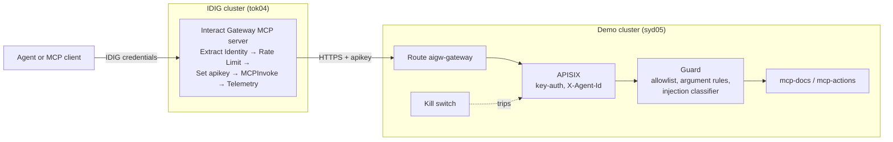

# Integrating with IBM DataPower Interact Gateway

A step-by-step guide to putting **IBM DataPower Interact Gateway** (IDIG) in front of the demo's MCP tools. This is the simplest integration: IDIG calls the demo's existing MCP routes on the gateway's public Route, and its policies are built around that call. Nothing in the demo changes (D-067).



**What each side does.** IDIG is the MCP endpoint that clients see: it issues their credentials, applies plans and rate limits, and records its own analytics. Behind it, everything the demo does still applies: the guard's tool allowlist, argument rules and injection classifier, the kill switch, and our traces, logs and dashboards.

**One limit to know up front.** The demo identifies an agent by its APISIX key, and IDIG holds one key per MCP server. So every caller of IDIG's docs server looks like the `researcher` to the guard, and every caller of its actions server looks like the `executor`.

## Before you start

| You need | Where | Check |
| --- | --- | --- |
| The demo running on the syd05 cluster | `aigw-gateway.apps.itz-0x5jw5.infra01-lb.syd05.techzone.ibm.com` | Step 1 |
| IDIG on the tok04 cluster, able to run new MCP servers | `idig-system` on `itz-lvn018` | Step 2 |
| The API Studio UI | `https://idig.apps.itz-lvn018.infra01-lb.tok04.techzone.ibm.com/` | You can sign in |
| The researcher and executor consumer keys | `.secrets/consumer-researcher`, `.secrets/consumer-executor` | Never put them in git |

`~/.kube/config` has a context for each cluster, and `oc` uses whichever is current. Before any `oc` command, or any `TARGET=openshift` script, check which cluster you're on:

```bash
oc whoami --show-server
oc config use-context default/api-itz-lvn018-infra01-lb-tok04-techzone-ibm-com:6443/kube:admin   # IDIG (tok04)
oc config use-context default/api-itz-0x5jw5-infra01-lb-syd05-techzone-ibm-com:6443/kube:admin   # demo (syd05)
```

## Step 1: Check the demo's MCP routes

These are the calls IDIG will make. Run them from your machine to confirm the routes answer before involving IDIG.

```bash
GW=https://aigw-gateway.apps.itz-0x5jw5.infra01-lb.syd05.techzone.ibm.com
KEY=$(cat .secrets/consumer-researcher)
mcp() {  # mcp <path> <key> <json-rpc body>
  curl -sk -H "apikey: $2" -H 'content-type: application/json' \
       -H 'accept: application/json, text/event-stream' "$GW$1" -d "$3"; echo
}

mcp /mcp/docs "$KEY" '{"jsonrpc":"2.0","id":1,"method":"initialize","params":{"protocolVersion":"2025-06-18","capabilities":{},"clientInfo":{"name":"check","version":"0"}}}'
mcp /mcp/docs "$KEY" '{"jsonrpc":"2.0","id":2,"method":"tools/list"}'
```

Expected, as checked on 2026-10-26:

| Call | Result |
| --- | --- |
| No key | `401` |
| `initialize` with the researcher key | `200`, server `mcp-docs`, protocol `2025-06-18`, plain JSON, **no `Mcp-Session-Id`** (the servers are stateless) |
| `tools/list` | `list_documents`, `read_document` (`{"id": "supplier-01"}` … `"supplier-07"`) |
| `read_document` `supplier-07` (Meridian) | `isError: true`, "Content quarantined by policy (decision dec-…)": the guard withheld the hidden instructions |
| `/mcp/docs` with the executor key | `403`: each route admits only its own agent |
| `/mcp/actions` with the executor key | `update_record`, `send_email` |

**The transport.** The guard speaks streamable HTTP with plain JSON responses only, and rejects SSE from upstream. Whatever IDIG sends, it gets JSON back.

## Step 2: Make sure IDIG can run new MCP servers

On 2026-10-26 this was the blocker. IDIG's images come from `tz-docker-registry.duckdns.org/kskhong` (the `imageRegistry` in the `DataPowerInteractGatewayCluster`), and the cluster can no longer reach it. Pods already running keep going because their images are cached on their nodes. Every new MCP server pod fails to pull, as the sample `transactions` server shows:

```bash
oc -n idig-system get pods | grep -E 'dpn-rt-|ImagePull'
oc -n idig-system describe pod -l nano.datapower.ibm.com/component=runtime | grep -A2 'Failed to pull' | head
```

**Fix it before publishing.** Whoever owns the tok04 cluster needs to make that registry reachable, or mirror IDIG's images and point `spec.imageRegistry` at the mirror. When the `dpn-rt-transactions-…` pod reaches `Running`, IDIG can run what you publish. Until then you can do steps 3 to 6 in API Studio, including **Test connection**, but the published endpoint won't come up.

## Step 3: Register the docs MCP server

In API Studio:

1. Open the project. Use `api-days-workshop`, or a new one if you'd rather keep the workshop project as it is.
2. **Create → MCP server → Register external MCP server.**
3. **Configure MCP server.** Name `supplier-docs`, version `1.0`, description: *Read-only supplier review documents, behind the AI gateway demo's guard.*
4. **Connect & authorize:**
   - MCP server URL: `https://aigw-gateway.apps.itz-0x5jw5.infra01-lb.syd05.techzone.ibm.com/mcp/docs`
   - Authorization: **API key**, header `apikey`, value: the contents of `.secrets/consumer-researcher`
   - **Test connection.** It should succeed and discover two tools.
5. **Select MCP tools:** `list_documents` and `read_document`. Then **Register**.

**The key here is only used for the test.** IDIG uses registration credentials to check the connection, not at runtime, so step 4 adds the header to the policy sequence.

The workshop project's existing `document-tools-policy` uses `Invoke` (with an empty URL) and an empty `Cache`. `Invoke` is the policy for MCP servers generated from REST APIs; an external MCP server uses `MCPInvoke`. Let the registration generate the server's own sequence, and delete or leave aside `document-tools-policy`, `invoke-document-tools-policy` and `Cache-wjbus`.

## Step 4: Build the policy sequence

**Form view → Explorer → Policy sequences → MCP servers → `supplier-docs`.** It starts with `MCPInvoke` and Telemetry. Make it:

| # | Policy | Settings | Why |
| --- | --- | --- | --- |
| 1 | **Extract Identity** *(optional)* | Your choice of caller identity (for example OAuth 2.0 from the `Authorization` header) | Only if callers authenticate with tokens rather than a subscription's client credentials |
| 2 | **Authenticate**, **Authorize** *(optional)* | Same namespace as Extract Identity | Pair with step 1 |
| 3 | **Rate Limit** | For example 60 a minute | Something IDIG adds that's visible in a demo |
| 4 | **Remove** | Request header `Authorization` | So the caller's own token never reaches the demo |
| 5 | **Set** | Request header `apikey` = the researcher key | How IDIG authenticates to APISIX. Without it, every call gets `401` |
| 6 | **MCPInvoke** | As generated | The call to `/mcp/docs` |
| — | **Telemetry** (monitoring) | As generated | IDIG analytics |

**Keep the key out of git.** `github.com/SamChinellato/api-days-agent-workshop` can be read without credentials. If the project is synced there, don't put the key in the Set policy inline. Use a secret or property reference if API Studio offers one, or keep this project unsynced. If a key does leak, rotate it: delete `.secrets/consumer-researcher`, re-run `scripts/gen-secrets.sh`, sync `aigw-workloads` in Argo CD so the gateway bootstrap applies the new key, and update the Set policy.

**Plans.** Give the server one plan that includes both tools, for example `supplier-docs-default-plan`. Later, plans can take over the guard's per-agent allowlists (see [Next steps](#next-steps)).

## Step 5: Register the actions MCP server

Repeat steps 3 and 4 with:

| | |
| --- | --- |
| Name | `supplier-actions` |
| URL | `https://aigw-gateway.apps.itz-0x5jw5.infra01-lb.syd05.techzone.ibm.com/mcp/actions` |
| Key | `.secrets/consumer-executor` |
| Tools | `update_record`, `send_email` |

The guard's argument rules still apply behind IDIG:

| Call | Outcome |
| --- | --- |
| `send_email` to a domain other than `demo.local` | Blocked |
| `update_record` on a field other than `status` or `notes` | Blocked |
| Either of the above | Critical, so the guard **trips the executor**, and every executor path stops, IDIG included, until it's reset |

`actions.export_customer_data` isn't in `tools/list`, so IDIG never discovers or exposes it. That's a second barrier in front of the guard's `deny_tools_all`.

## Step 6: Publish

1. **Publish** the project to the Nano Gateway. Optionally tick **Publish to Developer Portal**, so callers can subscribe and try it there.
2. Check what IDIG created on tok04:

   ```bash
   oc -n idig-system get runtimes.nano.datapower.ibm.com,mcptools,httproute -l managed-by=idig
   oc -n idig-system get pods | grep dpn-rt-supplier
   ```

   Each MCP server gets a `Runtime` (its own Deployment), an `MCPTool` per tool and an `HTTPRoute`. The endpoint has the form `https://<server>-<catalog>-<org>.nanogw.apps.itz-lvn018.infra01-lb.tok04.techzone.ibm.com/<version>`, for example `…/supplier-docs-…-sandbox-acme.nanogw…/1.0`. The publish result and the `HTTPRoute` give the exact host.
3. **Don't edit these CRs, and don't let Argo CD manage them.** They belong to IDIG (`managed-by: idig`) and are regenerated on every publish. Change the API Studio project and publish again. A publish restarts the server's pods, so expect a few seconds of errors.

## Step 7: Call it through IDIG

1. In the Developer Portal, create an application and subscribe it to the `supplier-docs` plan. Use the credentials it gives you, as the portal shows them (client ID header, or an OAuth token if you added steps 1–2 in step 4).
2. Call the IDIG endpoint the same way as in step 1, with IDIG's credentials instead of the APISIX key:

   ```bash
   IDIG=https://<host from step 6>/1.0
   curl -sk -H "<IDIG credential header>: <value>" -H 'content-type: application/json' \
        -H 'accept: application/json, text/event-stream' "$IDIG" \
        -d '{"jsonrpc":"2.0","id":1,"method":"tools/list"}'
   ```

   The Developer Portal's **Try out** does the same from the browser.
3. To use it from an MCP host (VS Code, Claude Desktop and so on), add it as a streamable HTTP server with that URL and header.

## Step 8: Show it working

| Try | Through IDIG you should see | Where to look |
| --- | --- | --- |
| `tools/call read_document {"id":"supplier-01"}` | The Northwind review | IDIG analytics: the call. Grafana **Decision trail**: the guard's `allow` for `researcher` |
| `tools/call read_document {"id":"supplier-07"}` | "Content quarantined by policy" | Grafana: a `block` of `mcp.tool_result_injection`. IDIG passed it on; the guard caught it |
| Exceed the rate limit | `429` from IDIG | IDIG analytics. Nothing reaches the demo |
| Trip `agent:researcher` in the kill-switch panel (`aigw-killswitch.<syd05 domain>`) | `503 kill_switch_engaged` | The kill-switch panel, and the IDIG call fails until you reset it |
| `send_email` to `someone@example.com` (actions server) | A policy error, and the executor is tripped | Grafana **Incident**: the auto-trip. Reset it in the panel |

**Traces.** IDIG keeps its own traces in its analytics. Our trace for the same call starts at APISIX. The two link up only if `MCPInvoke` forwards `traceparent`; check that in Tempo by looking for an incoming parent on the APISIX span.

## Troubleshooting

| Symptom | Likely cause | What to do |
| --- | --- | --- |
| Test connection fails | The URL, or the key header name | It's `apikey`, not `Authorization`. Run step 1 from your machine |
| The published server's pod is in `ImagePullBackOff` | The image registry (step 2) | Fix or mirror the registry |
| Every call through IDIG gets `401` | No Set policy for `apikey`, or it's after `MCPInvoke` | Step 4, row 5 |
| `403 consumer not allowed on this route` | The wrong agent's key for the route | Researcher key for `/mcp/docs`, executor key for `/mcp/actions` |
| `502` "SSE responses are not supported" | Something upstream answered in SSE | Shouldn't happen with the demo's servers; check that the URL is the gateway Route, not a service directly |
| `503 kill_switch_engaged` | The demo's kill switch is on for that agent, `tools` or `global` | Reset it in the panel, or **New chat** in the console |
| Decision trail shows calls as `researcher`, not the IDIG caller | Expected: identity comes from the APISIX key | See the first item in [Next steps](#next-steps) |

## Next steps

Each of these builds on this setup without changing it:

1. **Show IDIG callers as themselves.** Add an `idig` APISIX consumer and a matching guard policy entry, so IDIG traffic is told apart in the decision trail. Later, the on-behalf-of token exchange can carry the user and the agent as a JWT, validated by IDIG (`JWTProvider`) and the guard.
2. **Plans as allowlists.** One plan per agent selects its tools, and the guard's `mcp.tool_allowlist` drops to `monitor` mode as a cross-check.
3. **The guard as an IDIG policy.** A Lua Script policy on each tool sends the arguments and the result to the guard and blocks on its verdict. Still unknown: whether Lua is allowed in an MCP server's sequence, and what it can read there.
4. **The kill switch inside IDIG.** IDIG has no runtime admin API, so the kill switch can't write to it the way it writes to APISIX. It needs a per-request check against the kill switch's state, or IDIG's Valkey-backed block service.
5. **One observability picture.** Send IDIG's traces to our collector through its analytics offload, and turn spans into metrics there for the alerts.

What was found on the cluster, and the reasoning behind this plan, is in [DECISIONS.md D-067](DECISIONS.md#d-067-interact-gateway-integration-starts-in-front-of-the-existing-mcp-routes).
