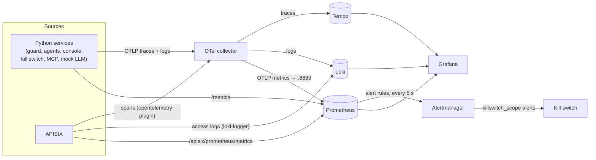

# Observability and evidence

What the demo records, where it goes, how to look at it, and how an incident becomes a tamper-evident evidence bundle. The components are introduced in [ARCHITECTURE.md](ARCHITECTURE.md).

## The rule: one task, one trace

A message you type produces **one trace** that covers everything it caused: the console, the gateway, both agents, every model and tool call, the guard's verdicts and any kill-switch trip. Every log line and decision record carries that trace's ID. So any single fact (a block, a trip, a slow call) leads to the full story with one click.

W3C trace context (`traceparent`) is passed on every call, including through APISIX (OBS-01, OBS-02). Our Python services send only the sampled flag, because APISIX's tracer starts a new trace if it sees the newer flag bits (D-061).

## Signals and where they go



| Signal | From | Path | Stored in |
| --- | --- | --- | --- |
| Service traces | every Python service (`demo_common`) | OTLP/HTTP → collector | Tempo |
| Service logs | every Python service; JSON on stdout too | OTLP/HTTP → collector | Loki: `trace_id`, `span_id` and record fields as structured metadata |
| Gateway spans | APISIX `opentelemetry` plugin (always-on sampling) | → collector | Tempo |
| Gateway access logs | APISIX `loki-logger` | direct to Loki's push API | Loki: trace ID, consumer, route, method, URI, status, latency, upstream. **No bodies** (GW-06) |
| Metrics | APISIX, every service's `/metrics`, the collector's exporter | scraped every 5 s | Prometheus |

Retention is 24 h, sampling is 100 % (OBS-07). On OpenShift, Loki and Tempo are multi-tenant and token-protected: the collector writes and Grafana reads with service-account tokens (D-058).

## Decision records

Every time the guard judges something, it writes one **decision record**, in three forms at once (GRD-05):

1. **A log line** (`event: guard_decision`) with: `decision_id`, `ts`, `trace_id`, `span_id`, `agent`, `check`, `mode`, `severity`, `verdict` (`allow`, `flag` or `block`), `score`, `rule_id`, `reason`, `route`, `tool`, `policy_version`, `content_sha256`, and a redacted `excerpt` (at most 500 characters, only for flags and blocks)
2. **A span event** `guard.decision` on the guard's span, so it appears inside the trace
3. **A counter**, `guard_decisions_total{agent, check, mode, verdict}`

The `reason` explains the verdict in words: for injection checks, the score, threshold and which signal fired; for tool checks, the policy rule and its contents (D-045). `policy_version` is the hash of the policy that made the decision, so a decision can be traced to the exact rules in force.

## Metrics

| Metric | From | Labels | Used by |
| --- | --- | --- | --- |
| `gateway_http_status`, `gateway_http_latency` | the gateway (APISIX) | route, consumer, code | Overview dashboard, `AgentToolCallSpike`, `GatewayErrorRate` |
| `gateway_llm_prompt_tokens`, `gateway_llm_completion_tokens` | the gateway (APISIX, measured there) | consumer | `TokenBurn`, token panels |
| `guard_decisions_total` | guard | agent, check, mode, verdict | `GuardBlockSpike`, block panels |
| `guard_inspect_seconds` | guard | stage | how long an LLM-route inspection took |
| `killswitch_active` | kill switch | scope | "Kill switches on", the state timeline |
| `killswitch_events_total` | kill switch | type, scope, source, verified | Incident dashboard |
| `agent_llm_tokens_total`, `agent_tool_calls_total`, `agent_tasks_total` | agents (self-reported) | agent, plus direction / tool, outcome / status | informational only; no alert relies on them |

## Alerts that stop agents

Prometheus evaluates `observability/alerts/killswitch.yaml` every 5 s. An alert with a `killswitch_scope` label goes through Alertmanager to the kill switch, which trips that scope (F6).

| Alert | Fires when | Trips |
| --- | --- | --- |
| `GuardBlockSpike` | 3 or more enforce-mode blocks of what one agent **sent** (its prompts, tool choices, arguments) within 2 min | that agent |
| `TokenBurn` | an agent's gateway-measured tokens exceed 50,000/min for 1 min | that agent |
| `AgentToolCallSpike` | an agent makes more than 40 tool calls/min (20 s window) for 5 s | that agent |
| `GatewayErrorRate` | non-503 5xx above 20 % for 1 min | nothing (notify only) |

Two details matter in practice (D-037):

- An agent that merely *reads* a poisoned document is the victim, so those blocks don't count toward `GuardBlockSpike`.
- An alert that started before the scope's last reset is ignored, so a still-firing alert can't undo an operator's reset.

## Dashboards

Grafana has four dashboards, generated from `observability/dashboards/build.py` and committed as JSON. Each refreshes every 5 s; guard blocks and kill-switch events appear as annotations on all of them.

| Dashboard | Panels | Use it for |
| --- | --- | --- |
| **AI Gateway Overview** | Requests/s · Blocked (15 min) · Kill switches on · LLM tokens/min · Requests by agent · Allowed, blocked, killed | The health of the gateway at a glance |
| **Agent Behaviour** | Tokens/min (with the TokenBurn line) · Tool calls/min · Guard blocks/min, per agent | Watching a rogue agent ramp up until the alert fires |
| **Incident** | Kill switches on · Alerts firing · Guard blocks · Kill-switch state timeline · Cut off by the kill switch | What was stopped, when, and for how long |
| **Decision trail** | Guard decisions in order · Kill-switch actions · The request, end to end | Why one request was allowed or stopped (`/d/decision-trail?var-trace_id=…`) |

Logs and traces are linked both ways: a Loki line's `trace_id` opens the trace in Tempo, and a span opens its logs (OBS-04).

### From the console

- **Decision trail** under a reply, and **why?** on a kill-switch notice, open the Decision trail dashboard for that request's trace.
- **Where it went** draws the message's path across the components, built from the request's real trace (`GET /console/api/flow/{trace_id}`): a dot where the gateway checked a link, a red diamond where it stopped something (D-046).

Telemetry takes a few seconds to arrive; if a trail is empty, wait about 10 s and refresh.

### Where to open them

| | k3d | OpenShift |
| --- | --- | --- |
| Grafana | `http://<host>:3000` (anonymous viewer; `admin` + `.secrets/grafana-admin-password` to edit) | `https://aigw-grafana.<domain>` (OpenShift login) |
| Prometheus | `http://<host>:9090` | `https://aigw-prometheus.<domain>` (OpenShift login, read-only) |
| Alertmanager | `http://<host>:9093` | `oc -n aigw-observability port-forward svc/aigw-alertmanager 9093` |

## Evidence bundles

`make evidence INCIDENT=<id>` (or `TRACE=<id>`) collects everything about one incident into `evidence/<id>/` (EVD-01 to EVD-07, D-041). *k3d only for now; OpenShift support is on the [roadmap](OPENSHIFT_MIGRATION.md#future-roadmap).*

```text
evidence/<id>/
  report.html  report.json  manifest.json
  raw/request.json             what was asked for, the search window, the trace IDs
  raw/traces/<trace>.json      Tempo, as returned
  raw/logs/<trace>.jsonl       Loki lines for each trace
  raw/guard-decisions.jsonl    the guard's flag and block records
  raw/killswitch/audit.jsonl   the whole kill-switch audit chain
  raw/metrics.json             fixed Prometheus queries over the window
  raw/config/apisix.json       routes, consumers, plugin configs; credentials removed
  raw/config/guard-policy.json the policy and its version hash
  raw/environment.json         versions.env, git SHA, running image digests
```

- **The report** has a summary (what happened, what was blocked, who acted), containment times (violation → trip → verified → reset), and an ordered timeline. Each timeline entry has an empty `control_refs: []`, reserved for mapping to a compliance framework.
- **Scoped to the incident.** A guard auto-trip names its trace and decision, so the bundle holds exactly those. An alert-driven trip takes that agent's blocks and traffic in the two minutes before it.
- **Deterministic.** The same `raw/` always produces a byte-identical `report.json` (sorted keys, no generation time; that's only in the manifest).
- **Tamper-evident.** `manifest.json` holds every file's SHA-256 and a bundle hash. `make evidence-verify DIR=evidence/<id>` recomputes them and re-checks the kill-switch audit hash chain; changing one byte anywhere fails it.
- **Redacted.** Emails, phone numbers and names are redacted in excerpts and the report; the bundle is scanned for every generated secret before it's sealed.
- **Viewing.** On k3d, the evidence viewer at `http://<host>:8099` serves `evidence/` read-only.
